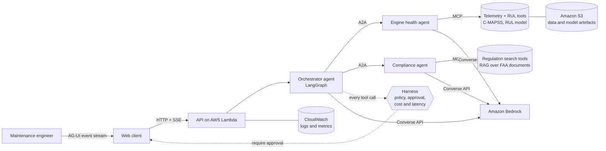

# AeroMRO Agentic Copilot

[](https://github.com/jeandirel/aeromro-agentic-copilot/actions/workflows/ci.yml)


An agentic copilot for aircraft engine maintenance (MRO: maintenance, repair and overhaul).
It helps a maintenance engineer answer questions such as:

> *Engine 31 of fleet FD001: how many cycles are left, and what does the regulation require
> before the next flight?*

To answer, a team of agents combines **engine sensor data** (remaining useful life predicted on the
NASA C-MAPSS dataset) with **regulatory documents** (retrieval over public FAA texts), cites its
sources, and **never takes a safety decision on its own**: risky actions wait for a human.

> **Status: early stage, step 1 of 7.** The foundations below are built and tested; the agents,
> protocols and AWS deployment are on the [roadmap](#roadmap). This README only describes what
> exists, and is updated at each step.

## What it demonstrates

| Topic | How |
| --- | --- |
| Agent architectures | LangGraph orchestrator delegating to specialist agents |
| Agentic interfaces | **MCP** for tools, **A2A** between agents, **AG-UI** towards the user ([why](docs/adr/0001-agent-protocols.md)) |
| Agent harness | Fail-closed action policy, human approval for side effects, token budget ([why](docs/adr/0003-fail-closed-harness.md)) |
| Cloud | Amazon Bedrock (Converse API), AWS Lambda, S3, CloudWatch ([why](docs/adr/0002-aws-bedrock-lambda.md)) |
| Cost, latency, reliability | Every LLM call recorded: tokens, cost, p50 / p95 latency |
| Industrial ML | Remaining useful life (RUL) prediction on turbofan run-to-failure data |
| Engineering | Typed Python, tests, lint, CI, Docker, architecture decision records |

## Architecture



Details in [docs/architecture.md](docs/architecture.md).

## What is built today (step 1)

- **One LLM interface, two implementations** (`aeromro.llm`): a deterministic mock, so tests and
  CI run offline at no cost, and an Amazon Bedrock client on the Converse API, which returns token
  usage and latency with every answer.
- **Action policy** (`aeromro.harness.policy`): each tool has a risk level; reads run, low-confidence
  recommendations and side effects go to a human, safety-critical actions and unknown tools are
  denied.
- **Telemetry** (`aeromro.harness.telemetry`): tokens, cost when prices are configured, p50 / p95
  latency and token budget per session.
- **C-MAPSS loader** (`aeromro.data.cmapss`): reads the NASA files and builds train and test RUL
  labels (clipped at 125 cycles by default).
- **Quality**: 34 tests, ruff, GitHub Actions on Python 3.11 and 3.12, Docker image.

```console
$ python -m aeromro
aeromro-agentic-copilot 0.1.0
llm provider : mock
action policy:
  READ      estimate_rul           -> allow
  READ      read_engine_telemetry  -> allow
  READ      search_regulations     -> allow
  RECOMMEND recommend_inspection   -> allow
  ACT       draft_work_order       -> require_approval
  FORBIDDEN ground_engine          -> deny
```

## Quickstart

```bash
git clone https://github.com/jeandirel/aeromro-agentic-copilot.git
cd aeromro-agentic-copilot
python -m venv .venv && source .venv/bin/activate
pip install -e ".[dev]"
make test       # pytest with coverage
make lint       # ruff
python -m aeromro
```

To call Amazon Bedrock instead of the mock, install the AWS extra, copy `.env.example` to `.env`,
set `AEROMRO_LLM_PROVIDER=bedrock` and a model id enabled in your account
(`AEROMRO_BEDROCK_MODEL_ID`), and use your usual AWS credentials.

```bash
pip install -e ".[aws]"
```

The dataset is not stored in the repository; see [docs/data.md](docs/data.md).

## Roadmap

- [x] **1. Foundations**: LLM interface (mock and Bedrock), harness policy and telemetry,
  C-MAPSS loader, CI, ADRs
- [ ] **2. RUL model**: baseline and stronger model on FD001 to FD004, RMSE and PHM08 score,
  model card
- [ ] **3. MCP tool servers**: engine telemetry and RUL tools; regulation search with citations
  over public FAA documents
- [ ] **4. Agents**: LangGraph orchestrator, engine health and compliance agents over A2A,
  harness wired into every tool call with human-approval interrupts
- [ ] **5. AG-UI interface**: live stream of reasoning steps, tool calls and approval requests
- [ ] **6. AWS deployment and evaluation**: Lambda, Bedrock, S3, CloudWatch as code; evaluation
  set (answer quality, citation accuracy, tool-call accuracy); cost and latency report
- [ ] **7. Results**: measured figures, limits, demo

## Project layout

```
src/aeromro/
  config.py          settings from AEROMRO_* environment variables
  llm/               LLM interface, mock client, Bedrock Converse client
  harness/           action policy, cost and latency telemetry
  data/              NASA C-MAPSS loader and RUL labels
tests/               unit tests (no network, no AWS account needed)
docs/                architecture, data sources, architecture decision records
```

## Disclaimer

Personal, educational project. It uses simulated engine data (NASA C-MAPSS) and public regulatory
texts only, no proprietary or export-controlled data. It is not a certified maintenance tool and
must not be used to make airworthiness decisions. Not affiliated with any aircraft or engine
manufacturer.

## License

[MIT](LICENSE) © 2026 Jean Direl
