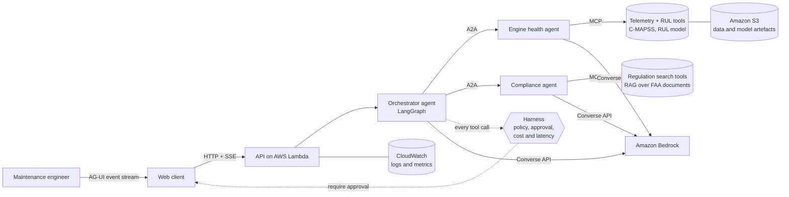

# Architecture

Target architecture of the copilot. Step 1 delivers the foundations (LLM interface, harness,
data loader); the other boxes are built in the steps listed in the README roadmap.

## The question it answers

A maintenance engineer asks, for example: *"Engine 31 of fleet FD001: how many cycles are left,
and what inspection does the regulation require before the next flight?"* The copilot has to
combine two kinds of evidence, numbers from the engine sensors and text from regulatory
documents, and it must never take a safety decision on its own.

## Components

| Layer | Role | Protocol | Built in |
| --- | --- | --- | --- |
| Web client | Streams the agents' reasoning steps, tool calls and approval requests to the engineer | AG-UI | step 5 |
| Orchestrator | Plans, routes the question to the right specialist, writes the final answer with its sources | LangGraph | step 4 |
| Specialist agents | Engine health (RUL, sensor trends) and compliance (regulatory requirements), each an independent service | A2A | step 4 |
| Tools | Read telemetry, estimate RUL, search regulations; exposed once, usable by any agent | MCP | step 3 |
| Harness | Checks every tool call against the action policy, asks a human when needed, records tokens, cost and latency | in-process | step 1 (policy, telemetry), step 4 (wiring) |
| LLM | One interface; mock offline, Amazon Bedrock in the cloud | Bedrock Converse | step 1 |
| Cloud | Serverless deployment, artefacts, observability | AWS Lambda, S3, CloudWatch | step 6 |

Why three protocols: see [ADR 0001](adr/0001-agent-protocols.md). Why Bedrock and Lambda: see
[ADR 0002](adr/0002-aws-bedrock-lambda.md). Why the harness fails closed: see
[ADR 0003](adr/0003-fail-closed-harness.md).

## Safety boundaries

- The copilot **recommends**; certified staff **decide**. Grounding an engine is a forbidden action
  for the agents, whatever the confidence.
- Anything that writes outside the agent (for example a draft work order) waits for an explicit
  human approval, surfaced in the user interface.
- Every answer cites the sensor data and the document passages it relies on.
- The data are public and simulated (NASA C-MAPSS) or public regulatory texts. No proprietary
  or export-controlled data are used.
