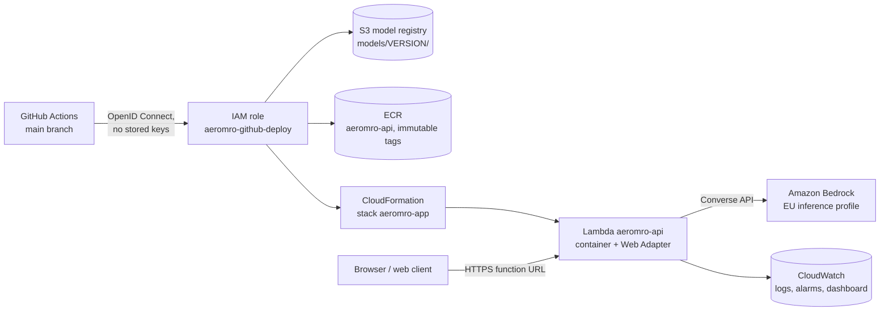

# Deployment on AWS

Region: **eu-west-3 (Paris)**. Model: **Amazon Nova 2 Lite** through the EU inference profile
`eu.amazon.nova-2-lite-v1:0` (requests stay within EU regions); any other Bedrock model can be
set with the repository variable `AEROMRO_BEDROCK_MODEL_ID`.

## One-time setup (account owner, about 15 minutes)

1. In the AWS console, region Europe (Paris): create a **zero-spend budget** alert.
2. In Amazon Bedrock, open the playground and send one prompt to Amazon Nova 2 Lite, to check the
   account has access to the model.
3. In CloudFormation, create the stack `aeromro-bootstrap` from [`infra/bootstrap.yaml`](../infra/bootstrap.yaml)
   (acknowledge IAM resources). It creates:
   - the GitHub OpenID Connect provider and the role `aeromro-github-deploy`, which only the main
     branch of this repository can assume;
   - the model registry bucket `aeromro-artifacts-ACCOUNT-REGION` (private, encrypted, versioned);
   - the image registry `aeromro-api` (scan on push, immutable tags, last 10 images kept);
   - the permissions boundary `aeromro-boundary`, which caps every role the deployments create:
     logs, metrics, Bedrock model calls and read access to the registry, nothing else.
4. In the GitHub repository settings, add the variable `AWS_DEPLOY_ROLE_ARN` (stack output
   `DeployRoleArn`) and, optionally, the secret `AEROMRO_DEMO_ACCESS_CODE`.

## Pipeline

| Workflow | Trigger | What it does |
| --- | --- | --- |
| `ci.yml` | every push and pull request | lint, 92 tests on Python 3.11 / 3.12, builds and starts the Lambda image on synthetic data |
| `train.yml` | manual | downloads NASA C-MAPSS (checksums verified), trains and evaluates, publishes the models to `s3://…/models/VERSION/` and marks them as latest |
| `deploy.yml` | push to main touching the app, or manual | fetches the latest models, checks they load and score their fleets, builds and pushes the image, deploys [`infra/app.yaml`](../infra/app.yaml), calls the live API |

Training and the API image install the same pinned versions (`requirements/runtime.txt`), so a
model is always loaded by the library version that produced it.

## What runs

- **Lambda `aeromro-api`**: FastAPI app in a container behind the AWS Lambda Web Adapter, 2048 MB,
  30 s timeout, x86_64. Fleet assessments are computed when the image is built, so listing a
  fleet does not run the model at request time.
- **Function URL** (public HTTPS). `POST /ask` is the only endpoint that calls the language model;
  it is rate-limited per client and can require an access code (`X-Access-Code` header).
- **CloudWatch**: logs kept 14 days, alarms on errors and throttles, dashboard `aeromro-api`
  (invocations, errors, p50 / p95 duration, concurrency).

## API

| Method and path | Returns |
| --- | --- |
| `GET /health` | status, version, LLM provider, deployed subsets |
| `GET /fleets` | per subset: engines, status counts, model test metrics |
| `GET /fleets/{subset}/engines?status=` | every in-service engine: RUL, 80 % interval, status, confidence |
| `GET /fleets/{subset}/engines/{unit}?history=60` | one engine: assessment, RUL and key sensors over the last cycles |
| `POST /ask` | an explanation by the language model, the harness policy decision, tokens, latency and cost |
| `POST /mcp` | MCP endpoint (Streamable HTTP, stateless, JSON responses): the fleet tools |
| `GET /audit?limit=50` | latest tool calls seen by the harness on this instance |

Interactive documentation is served at `/docs`.

Status rule: `inspect_now` if the estimate is at most 15 cycles, `plan_inspection` up to 50,
`healthy` above. The confidence is the share of the 80 % interval that falls in the same status
band as the estimate; a recommendation below 0.7 is flagged for human approval by the harness.

## When the language model is unavailable

`POST /ask` never depends on Bedrock alone. If the call fails (quota exhausted, throttling,
access denied, timeout), the answer is built from the same facts without a language model, marked
`[summary without language model]`, and the response carries `fallback_reason` (the AWS error
code). A circuit breaker then skips Bedrock for 5 minutes instead of failing again on every
request, and lets one call through afterwards to detect recovery. The Bedrock client itself uses
2 attempts and bounded timeouts, so a slow model hands over quickly.

New AWS accounts can start with a Bedrock quota of 0 tokens per day
(`ThrottlingException: Too many tokens per day`); the quota is raised through Service Quotas or
an AWS Support case. The demo keeps working in the meantime thanks to the fallback.

## Cost and limits

- New accounts on the AWS free plan have credits that cover this demo; the zero-spend budget
  warns at the first cent.
- Bedrock is billed per token; `/ask` caps the answer at 400 tokens and the prompt is a short
  facts block.
- Lambda concurrency is capped by the account quota (10 on new accounts): beyond that, requests
  are throttled, never billed.
- The rate limit is kept in memory, per Lambda instance: it slows abuse, it is not a hard quota.
  A shared quota (DynamoDB or API Gateway usage plans) is the next step if the demo becomes public.
